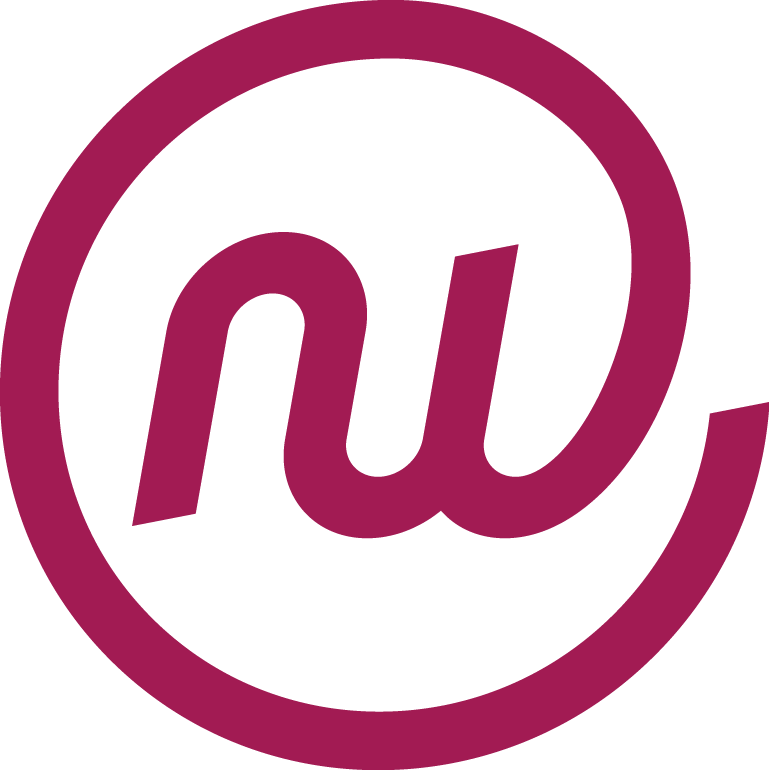
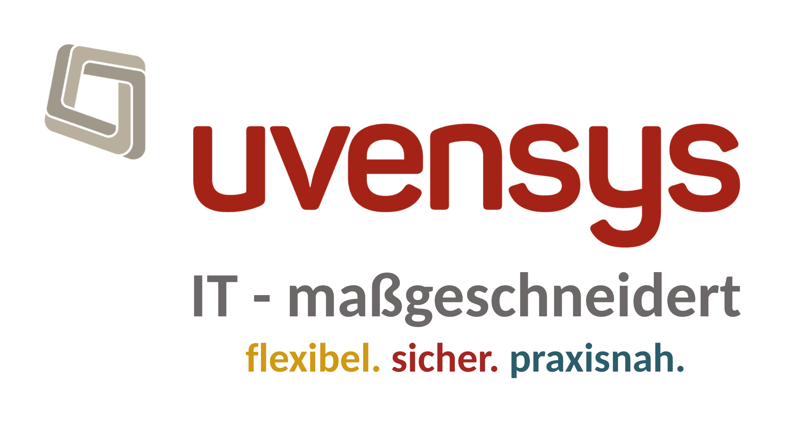
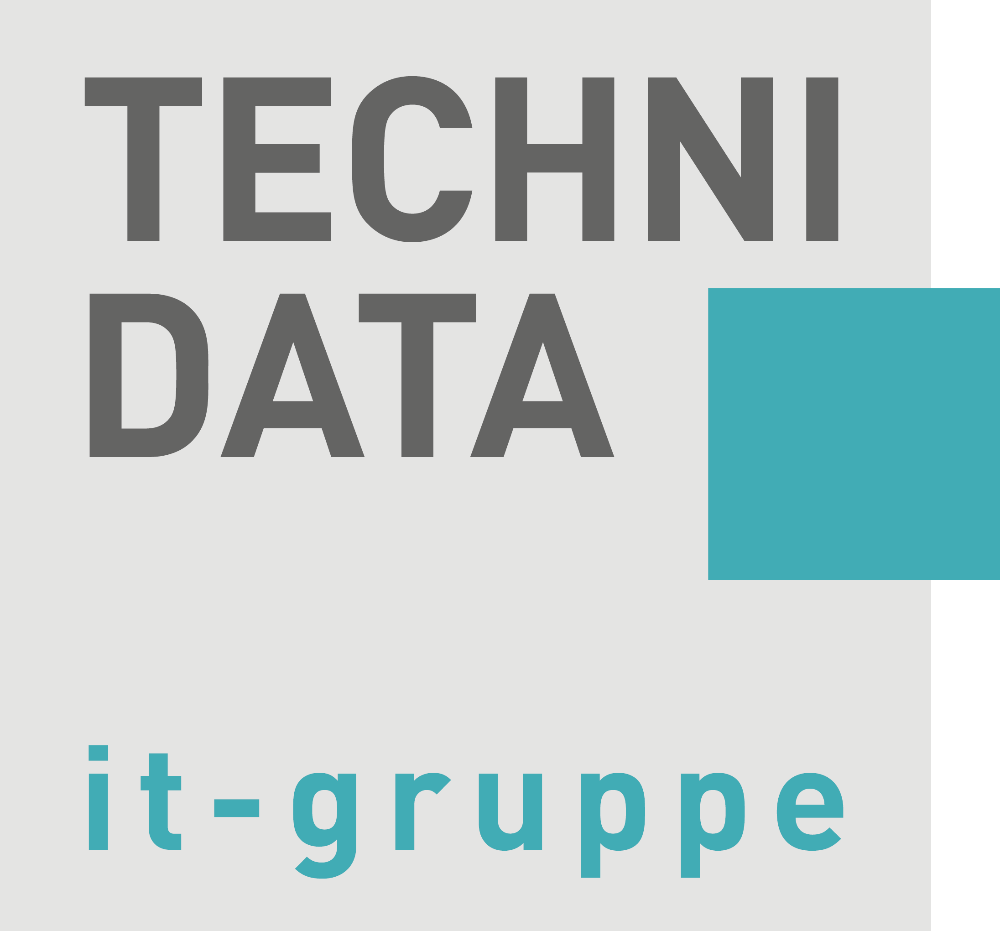

# proxmox-tg

Форк [PegaProx](https://github.com/PegaProx/project-pegaprox) (v1.4.1) для удобного управления Proxmox VE и Proxmox Backup Server.

Что добавлено к PegaProx:
- русский перевод интерфейса (переключатель RU);
- Telegram-бот с правами вашего пользователя PegaProx: см. [tgbot/README.md](tgbot/README.md);
- пользователи и права самого Proxmox VE: «Датацентр → Пользователи Proxmox» (пользователи,
  группы, свои роли, права на пути, просмотр областей входа). Раздел виден только
  администраторам PegaProx; изменения идут в кластер с учётными данными, которые PegaProx
  хранит для него, и пишутся в журнал аудита;
- обновления берутся из этого репозитория, а не из оригинального PegaProx.

Установка в LXC-контейнер Proxmox: [docs/install-lxc-ru.md](docs/install-lxc-ru.md).

Лицензия: AGPL-3.0, как у оригинального проекта (см. `LICENSE` и `NOTICE`). Ниже перевод
оригинального README PegaProx; команды установки и обновления в нём заменены на команды
для этого форка.

---

<p align="center">
  <picture>
    <!-- GitHub dark mode → swap to light variant so it stays readable -->
    <source media="(prefers-color-scheme: dark)" srcset="images/pegaprox-logo-light.png">
    
  </picture>
</p>

<h1 align="center">PegaProx</h1>

<p align="center">
  <strong>Современное управление несколькими кластерами Proxmox VE и XCP-ng</strong>
</p>

<p align="center">
  <a href="https://pegaprox.com">Сайт</a> •
  <a href="https://docs.pegaprox.com">Документация</a> •
  <a href="https://github.com/PegaProx/project-pegaprox/releases">Релизы</a> •
  <a href="https://plugins.pegaprox.com/">Плагины</a> •
  <a href="https://opencollective.com/pegaprox">Спонсорство</a> •
  <a href="https://pegaprox.com/sponsors.html">Коммерческая поддержка</a>
</p>

<p align="center">
  
  
  
</p>

<p align="center">
  <a href="https://app.aikido.dev/audit-report/external/aklfeBsCvIheXnWMwFRveeH5/request" target="_blank">
    
  </a>
</p>

---

## 🚀 Что такое PegaProx?

PegaProx это веб-интерфейс для управления кластерами Proxmox VE и XCP-ng. Несколько кластеров
в одной панели: мониторинг в реальном времени, управление VM, автоматические задачи и многое
другое.

<p align="center">
  
</p>

### 🪽 Откуда название?

Название **PegaProx** составлено из *Пегаса*, крылатого коня из греческой мифологии, и *Prox*
от Proxmox VE. Пегас символизирует скорость, свободу и лёгкий полёт: этого авторы хотят и для
управления гипервизорами в нескольких кластерах.

## ❤️ Спонсоры

> PegaProx это открытый проект сообщества, который **живёт только на спонсорские деньги и пожертвования**. Серверы, домены, сертификаты для подписи кода и время разработчиков на каждый релиз оплачиваются из своего кармана и из взносов компаний и людей ниже. Если PegaProx экономит вам время на работе, подумайте о том, чтобы [стать спонсором](mailto:sponsor@pegaprox.com) или поддержать проект на [Open Collective](https://opencollective.com/pegaprox). Каждый евро помогает. 💛

### 💎 Платина

<p align="center">
  <a href="https://www.netwolk.ch">
    
  </a>
  &nbsp;&nbsp;&nbsp;
  <a href="https://expertize.nl/">
    
  </a>
  &nbsp;&nbsp;&nbsp;
  <a href="https://netzware.at/">
    
  </a>
  &nbsp;&nbsp;&nbsp;
  <a href="https://www.occentus.net/">
    
  </a>
</p>

### 🥇 Золото

<p align="center">
  <a href="https://socialfurr.com">
    
  </a>
</p>

### 🥈 Серебро

<p align="center">
  <a href="https://uvensys.de/">
    
  </a>
  &nbsp;&nbsp;
  <a href="https://www.datimo.ch/">
    
  </a>
  &nbsp;&nbsp;
  <a href="https://www.technidata.de/">
    
  </a>
</p>

### 🥉 Бронза

<p align="center">
  <a href="https://idkmanager.com/">
    
  </a>
  <a href="https://www.linet-services.de/">
    
  </a>
</p>

<p align="center">
  <sub><b>Частные спонсоры:</b>&nbsp; Andreas Huemmer</sub>
</p>

<p align="center">
  <a href="mailto:sponsor@pegaprox.com">Стать спонсором</a> •
  <a href="https://opencollective.com/pegaprox">Open Collective</a> •
  <a href="https://pegaprox.com/sponsors.html">Коммерческая поддержка</a>
</p>

## ✨ Возможности

### Несколько кластеров
- 🖥️ **Единая панель** - все кластеры Proxmox в одном месте
- 📊 **Метрики в реальном времени** - CPU, RAM и хранилища через SSE
- 🔄 **Живая миграция** - перенос VM между нодами одним щелчком
- ⚖️ **Балансировка между кластерами** - распределение нагрузки по кластерам
- 🛣️ **Сеть передачи** - отдельная сеть в каждом кластере для данных дисков при миграциях и репликации между кластерами и запусках Site Recovery, в обход сети управления ([документация](docs/transfer-network.md))
- 🔄 **Миграция между гипервизорами** - перенос VM между ESXi, Proxmox VE и XCP-ng

### VM и контейнеры
- ▶️ **Быстрые действия** - запуск, остановка, перезагрузка VM и контейнеров
- ⚙️ **Настройка VM** - CPU, RAM, диски, сеть, EFI, Secure Boot и другое
- 📸 **Снапшоты** - обычные и экономные снапшоты LVM для общих хранилищ
- 🔁 **Репликация снапшотами** - репликация на любом хранилище, для кластеров без ZFS
- 💾 **Бэкапы** - расписание и управление бэкапами
- ✅ **Проверка бэкапов** *(экспериментально)* - автоматически: восстановление → загрузка → проверка состояния → очистка (для ISO 27001, SOC 2, HIPAA)
- 🖱️ **Консоль noVNC / xterm.js** - консоль QEMU и LXC в браузере
- ⚖️ **Балансировка** - автоматическое распределение VM по нодам
- 🔁 **Высокая доступность** - перезапуск гостей упавшей ноды на других нодах, с фенсингом, агентом самоизоляции и только для гостей, чьи тома лежат на общем хранилище
- 📍 **Правила размещения** - держать VM вместе или раздельно (QEMU и LXC)

### Интеграция с XCP-ng (предварительная версия)
- 🟢 **Пулы XCP-ng** - пулы XCP-ng / Xen рядом с кластерами Proxmox
- ▶️ **Управление питанием VM** - запуск, остановка, выключение, перезагрузка, приостановка и возобновление
- 🖥️ **Консоль VNC** - удалённая консоль в браузере через XAPI
- 💽 **Диски и сеть** - добавление, изменение размера, удаление дисков и сетевых карт
- 🔧 **Режим обслуживания** - вход и выход с автоматической эвакуацией VM

### Миграция с ESXi
- 🔀 **Мастер импорта ESXi** - перенос VM с хостов ESXi в Proxmox
- ⚡ **Почти без простоя** - перенос работающих VM с минимальным перерывом (рекомендуется не больше 1 VM за раз)
- 🔌 **Офлайн-миграция** - выключение и перенос для максимальной надёжности
- 🔑 **Нужен SSH** - на хосте ESXi должен быть включён SSH

### Безопасность и доступ
- 👥 **Много пользователей** - роли (администратор, оператор, наблюдатель) и свои роли
- 🛠️ **API-токены** - создание, список и отзыв Bearer-токенов (с ограничением по роли)
- 🔐 **Двухфакторная аутентификация** - TOTP (можно сделать обязательной)
- 🔑 **WebAuthn / FIDO2** - вход по аппаратному ключу (YubiKey, Nitrokey, Touch ID, Windows Hello), без пароля или как второй фактор
- 🏛️ **LDAP / OIDC** - Active Directory, OpenLDAP, Entra ID, Keycloak, Google Workspace, Authentik (с PKCE)
- 🛡️ **Права на уровне VM** - детальные права на каждую VM
- 🏢 **Мультиарендность** - изоляция кластеров разных клиентов
- 🚫 **Белые и чёрные списки IP** - ограничение доступа по IP или подсети CIDR
- 🔒 **Шифрование всей базы** - SQLCipher (AES-256-CBC + HMAC-SHA512, формат v4) шифрует всю базу на диске на Linux x86_64; на других платформах важные поля шифруются по отдельности (Fernet). Ключ ищется в переменной окружения, systemd LoadCredentialEncrypted или `/etc/pegaprox/secret.key`, поэтому бэкап `config/` не содержит ключа рядом с данными. Незашифрованная база шифруется автоматически при первом запуске после обновления.
- 🔍 **Сканер CVE** - поиск уязвимых пакетов на каждой ноде через debsecan
- 🛡️ **Укрепление по CIS** - аудит и укрепление по CIS benchmarks одним щелчком
- 🧾 **Журнал аудита с подписью HMAC** - каждая запись проверяется на подделку

### Автоматизация и мониторинг
- ⏰ **Задачи по расписанию** - автоматические действия с VM (запуск, остановка, снапшот, бэкап)
- 📸 **Расписания снапшотов** - политики по тегам или списку VMID с очисткой старых (ежечасно / ежедневно / еженедельно + «хранить последние N» + «хранить N дней»)
- 🔄 **Поочерёдное обновление нод** - ноды обновляются по одной с автоматической эвакуацией
- 🚨 **Оповещения** - о высокой загрузке CPU, памяти или диска
- 📜 **Журнал аудита** - все действия пользователей с IP-адресами
- 🔎 **Поиск по аудиту** - полнотекстовый поиск, фильтры по датам, важности и IP, постраничный вывод, экспорт в CSV
- 🛰️ **Пересылка в SIEM** - события аудита в Syslog (UDP/TCP RFC 5424), Splunk HEC, Elasticsearch, Loki или вебхуки, с проверкой TLS для каждого получателя
- 🔧 **Свои скрипты** - запуск скриптов на нодах
- 💿 **Управление Ceph** - мониторинг и управление пулами Ceph, зеркалирование RBD
- 🔐 **ACME / Let's Encrypt** - автоматическое продление SSL-сертификатов через HTTP-01 (и свои ACME CA)
- 📋 **Встроенный syslog-сервер** - приём и просмотр сообщений syslog (UDP/TCP) с фильтрами, поиском и цветами по важности
- 🧬 **Контроль расхождений конфигурации** - ночной снимок конфигурации кластера (конфиги VM, storage.cfg, сеть, параметры датацентра) и оповещение о любом изменении относительно базовой линии администратора. Работает вместе с панелью соответствия.

### Отчёты и аналитика
- 💰 **Затраты / распределение расходов** - €/VM/месяц по реальным метрикам (CPU-часы × тариф ноды + ГБ-часы RAM + ГБ-месяцы хранилища). Валюта и тарифы по кластерам настраиваются, таблица самых затратных VM, разбивка по нодам. Экспорт в CSV и PDF.
- ⚡ **Энергия и углерод** - оценка кВт·ч, €/месяц и кг CO₂/месяц на VM по истории метрик × профилю питания ноды × PUE × углеродной интенсивности сети. Значения по умолчанию для Германии и ЕС, настраиваются под любое железо и сеть. Экспорт в CSV и PDF.
- 🧠 **Рекомендации** - подбор размера (лишние или недостающие CPU и RAM, простаивающие VM) и прогноз ёмкости (линейная регрессия и срок до порога) по 30 дням истории. Экспорт в PDF.
- 🌐 **Топология сети** - интерактивный SVG-граф: кластер → ноды → мосты / бонды / SDN VNet → VM. Щелчок подсвечивает связи.
- 📊 **Панель соответствия** - соответствие BSI Grundschutz / ISO 27001 / NIS2 / SOC 2 по каждому кластеру, оценка укреплённости, экспорт в PDF. Только чтение, доступна операторам и аудиторам без прав администратора.
- 🛡️ **Отчёты по CVE** - число уязвимостей по важности для кластера, подробности по пакетам и история появления каждой CVE.

### Эксплуатация и развёртывание
- ☁️ **Библиотека шаблонов Cloud-Init** - подобранный каталог поддерживаемых облачных образов Ubuntu LTS, Debian, AlmaLinux, Rocky Linux, Fedora и Alpine (еженедельная проверка в CI находит битые ссылки и релизы с истёкшей поддержкой) и свои шаблоны администратора. Развёртывание в любой кластер одним щелчком (скачивание → импорт → диск cloudinit → шаблон).
- 🚑 **Site Recovery** - планы аварийного восстановления (порядок загрузки, зависимости, соответствие реплик) и управляемое переключение с журналом аудита.
- 📦 **Контроль SLA бэкапов** - панель SLA по кластерам и хранилищам: возраст последнего бэкапа против заданного RPO, с оповещениями.
- 🔁 **Репликация ZFS и между кластерами** - мониторинг встроенной репликации PVE и репликация между кластерами без общего хранилища.
- 🪽 **Высокая доступность самого PegaProx** - до 4 экземпляров PegaProx в группе: резервные хранят копию конфигурации, показывают живой вид и передают изменения лидеру; переключение вручную с подтверждением или (бета, включается для группы) автоматически по большинству голосов, с необязательным свидетелем как третьим голосом
- 🧩 **Автоматическая установка PVE** - файлы ответов для автоустановщика Proxmox VE из профилей (мастер или редактор) и отслеживание каждой установки
- 🛠️ **Миграция V2P / ESXi** - на основе Pyvmomi и SSHFS, с заранее подготовленными драйверами VirtIO через пакетную установку MSI (для Windows).

### Уведомления
- 📢 **Каналы вебхуков** - Slack, Discord, Microsoft Teams, ntfy, обычные JSON-вебхуки (несколько каналов, маршрутизация по оповещениям)
- 🔔 **Push-уведомления в браузере** - через VAPID, по схеме «разбудить» (данные не уходят push-провайдеру). Входящие в колокольчике сверху со счётчиком непрочитанных.
- 📲 **PWA / устанавливаемое приложение** - кэш оболочки в Service Worker, запуск без сети, предложение установки, цвет темы под оформление.

### Плагины
- 🌐 **Клиентский портал** - самообслуживание для клиентов хостинга: питание VM, консоль noVNC, снапшоты, подключение ISO, политики снапшотов (только чтение), 2FA и смена пароля
- 📊 **Публичная страница статуса** - состояние кластеров для экранов мониторинга с ключом в URL (без входа)
- 🔔 **Плагин уведомлений** - интеграция ntfy и Apprise для единой маршрутизации каналов
- 🐳 **Docker Swarm Manager** *(от сообщества)* - управление сервисами Swarm в том же интерфейсе
- 🗄️ **TrueNAS SCALE Manager** *(от сообщества)* - мониторинг и администрирование TrueNAS SCALE (пулы, датасеты, снапшоты, шары SMB/NFS, репликация, приложения и VM, службы, защита данных, телеметрия) через JSON-RPC 2.0
- 🔌 **Редактор настроек плагинов** - настройки плагинов прямо из интерфейса

### Дополнительно
- 🌐 **Офлайн-режим** - работает без интернета (локальные ресурсы; режим air-gap отключает внешние запросы CVE и спонсоров для закрытых сетей)
- 🎨 **Темы** - 17 тем: тёмная и светлая, Proxmox, Corporate (светлая и тёмная), Dracula, Nord, Monokai, Solarized, Cyberpunk и другие
- 🏢 **Корпоративный вид** - боковое дерево и плотные таблицы
- 🌍 **Много языков** - английский, немецкий, французский, испанский, португальский, польский, корейский, итальянский, упрощённый китайский, а в этом форке и русский
- 📱 **Адаптивность и PWA** - работает на компьютере и телефоне, устанавливается как приложение
- 📦 **Интеграция с PBS** - управление Proxmox Backup Server и проверка бэкапов
- 🔭 **Экспорт для Prometheus** - `/api/metrics` с Bearer-токеном (администратора или с правом `metrics.view`): метрики кластеров, нод, гостей, хранилищ, репликации и возраста бэкапов

## 📋 Требования

- Python от 3.10 до 3.13 (рекомендуется 3.12)
- Proxmox VE 8.0+ или 9.0+ и/или XCP-ng 8.2+
- Современный браузер (Chrome, Firefox, Edge, Safari)

## ⚡ Быстрый старт / установка

Подробная пошаговая инструкция для LXC-контейнера в Proxmox: [docs/install-lxc-ru.md](docs/install-lxc-ru.md).

### Установка из клона (рекомендуется)

`deploy.sh`, запущенный из клона, ставит файлы этого форка: зависимости, пользователя
`pegaprox`, venv, ключ шифрования и службу `pegaprox`.

```bash
git clone https://github.com/NeciMNK/proxmox-tg.git /opt/proxmox-tg-src
cd /opt/proxmox-tg-src
sudo bash deploy.sh --port=5000 --no-interactive
```

Пока репозиторий закрытый, `git clone` попросит логин и токен GitHub с правом чтения.

### Ручной запуск из исходников

Для разработки и отладки:

```bash
git clone https://github.com/NeciMNK/proxmox-tg.git
cd proxmox-tg
pip install -r requirements.txt
python3 pegaprox_multi_cluster.py
```

### Docker

Локальная сборка из этого форка:

```bash
git clone https://github.com/NeciMNK/proxmox-tg.git
cd proxmox-tg
docker build -t pegaprox .
docker run -d --name pegaprox \
  -p 5000:5000 -p 5001:5001 -p 5002:5002 \
  -v pegaprox-config:/app/config \
  -v pegaprox-logs:/app/logs \
  --restart unless-stopped \
  pegaprox
```

Готовые образы `ghcr.io/pegaprox/pegaprox` и `pegaprox/pegaprox` на Docker Hub, пакет из
APT-репозитория gyptazy и `docker compose up -d` с файлом из репозитория ставят
**оригинальный** PegaProx, без перевода, бота и раздела пользователей Proxmox. Образы
оригинала, начиная с 1.4.1, подписаны (build provenance), проверка:

```bash
gh attestation verify oci://ghcr.io/pegaprox/pegaprox:<version> -R PegaProx/project-pegaprox
```

### Пакет Debian (сборка .deb)

```bash
git clone https://github.com/NeciMNK/proxmox-tg.git
cd proxmox-tg

dpkg-buildpackage -us -uc
sudo dpkg -i ../pegaprox_*.deb
```

## 🔄 Обновление

Обновления берутся из этого репозитория (`NeciMNK/proxmox-tg`), оригинальный PegaProx и его
зеркало отключены: они затёрли бы доработки форка.

**Вариант 1: из клона** (работает и с закрытым репозиторием)

```bash
cd /opt/proxmox-tg-src
git pull
sudo bash deploy.sh --port=5000 --no-interactive
```

**Вариант 2: скрипт обновления или веб-интерфейс**

```bash
sudo bash /opt/PegaProx/update.sh
```

или в настройках PegaProx кнопка «Проверить обновления». Работает, когда репозиторий
публичный и в новой версии поднят номер `version` в `version.json` и `PEGAPROX_VERSION`
в `pegaprox/constants.py`.

## 🔧 Настройка

После запуска откройте в браузере:

```
https://адрес-сервера:5000
```

Паролей по умолчанию нет:

1. **Мастер настройки**: при первом входе открывается мастер, где создаётся первый администратор
2. **Добавьте кластер**: кнопка «Добавить кластер», адрес ноды и учётные данные Proxmox
3. **Готово!** Можно управлять VM

## 📁 Структура каталогов

```
/opt/PegaProx/
├── pegaprox_multi_cluster.py   # точка входа
├── pegaprox/                   # пакет приложения
│   ├── app.py                  # фабрика приложения Flask
│   ├── constants.py            # константы конфигурации
│   ├── globals.py              # общее состояние
│   ├── api/                    # REST API (blueprints)
│   ├── core/                   # бизнес-логика (менеджер, БД, кэш)
│   ├── background/             # фоновые задачи (планировщик, оповещения)
│   ├── utils/                  # утилиты (аутентификация, RBAC, LDAP, OIDC)
│   └── models/                 # модели данных
├── web/
│   ├── index.html              # собранный фронтенд
│   └── src/                    # исходники фронтенда (JSX)
├── config/
│   └── pegaprox.db             # база SQLite: целиком зашифрована SQLCipher (Linux x86_64); на других платформах обычный SQLite и зашифрованные Fernet поля
├── static/                     # JS/CSS-библиотеки (офлайн-режим)
├── logs/                       # журналы приложения
└── update.sh                   # скрипт обновления
```

Telegram-бот ставится отдельно в `/opt/proxmox-tg-bot`, см. [tgbot/README.md](tgbot/README.md).

## 🔒 Безопасность

- **База на диске** → SQLCipher (AES-256-CBC + HMAC-SHA512, формат SQLCipher v4) на Linux x86_64. На других платформах (ARM / macOS / Windows) обычный SQLite и Fernet для отдельных полей. Модель угроз и восстановление: [`docs/SECURITY.md`](docs/SECURITY.md).
- **Хранение главного ключа** → по порядку: переменная `PEGAPROX_DB_KEY` / systemd `LoadCredentialEncrypted` (привязка к TPM2) / `/etc/pegaprox/secret.key` / `~/.config/pegaprox/secret.key` / старое место в `config/`. Права по умолчанию 0600; файлы со слишком открытыми правами пропускаются, а не используются молча.
- **Важные поля** (пароли кластеров, SSH-ключи, секреты TOTP, секреты клиентов OIDC, учётная запись LDAP) → Fernet; работает, даже когда шифрование всей базы недоступно.
- **API-токены** → хэш SHA-256 (сравнение за постоянное время).
- **Пароли** → Argon2id (3 итерации, 64 МБ памяти).
- В рабочей среде обязателен HTTPS.
- Сессии истекают после простоя; можно жёстко привязать сессию к IP.
- Ограничение частоты запросов по IP на вход и на каждый запрос с аутентификацией.
- Проверка входных данных, сверка Origin против CSRF, RBAC на сервере для каждого маршрута.
- Автоматическое шифрование при первом запуске; отключается через `PEGAPROX_DISABLE_AUTO_ENCRYPT=1`, если сначала нужно сделать свой бэкап.

## 📖 Документация

Полная документация оригинального PegaProx (на английском): **[docs.pegaprox.com](https://docs.pegaprox.com)**

## 📜 Лицензия

Проект распространяется по лицензии AGPL-3.0, подробности в файле [LICENSE](LICENSE).

**Указание авторства (AGPL §7b):** по разделу 7(b) AGPL надпись **«Powered by PegaProx»** в клиентском портале является *обязательным* указанием авторства и должна сохраняться во всех копиях и изменённых или производных версиях, см. файл [NOTICE](NOTICE). Кроме того, AGPL §13 требует, чтобы тот, кто предоставляет **изменённую** версию пользователям по сети, опубликовал для них полный исходный код этой версии. PegaProx распространяется только по AGPL-3.0, указание авторства обязательно для всех без исключений.

## 💬 Поддержка

Вопросы по доработкам этого форка (перевод, Telegram-бот, пользователи Proxmox, обновления):
[Issues этого репозитория](https://github.com/NeciMNK/proxmox-tg/issues).

Оригинальный PegaProx:
- 💬 Discord: [сервер сообщества](https://discord.gg/AJPf3H62QW)
- 📧 Почта: support@pegaprox.com
- 🐛 Ошибки: [GitHub Issues](https://github.com/PegaProx/project-pegaprox/issues)

## 🤖 Инструменты разработки

Как и большинство современных команд, авторы PegaProx используют инструменты на основе ИИ (автодополнение кода, генерация документации, автоматизация ревью, аудит безопасности). Архитектурные решения, реализацию и тестирование выполняет команда из трёх человек. См. [IBM](https://www.ibm.com/solutions/ai-coding), [IBM Case Studies](https://www.ibm.com/case-studies/ibm-software-team), [MIT Tech Review](https://www.technologyreview.com/2025/12/15/1128352/rise-of-ai-coding-developers-2026/).

Аудит безопасности с помощью ИИ стал отраслевой практикой: см. [Hacker News](https://thehackernews.com/2026/02/claude-opus-46-finds-500-high-severity.html), [IBM Research](https://www.ibm.com/think/insights/chatgpt-4-exploits-87-percent-one-day-vulnerabilities).

Доработки этого форка написаны с помощью Claude Code.

## ⭐ История звёзд

Если PegaProx вам полезен, поставьте звезду оригинальному проекту! ⭐

---

<p align="center">
  Сделано с ❤️ командой PegaProx
</p>
